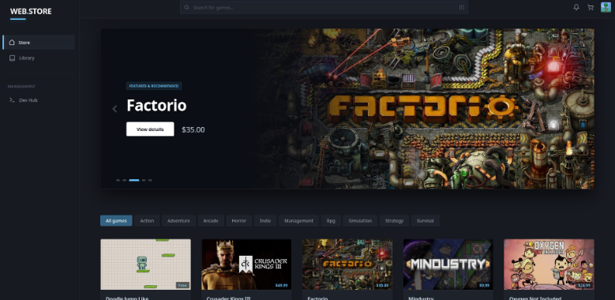
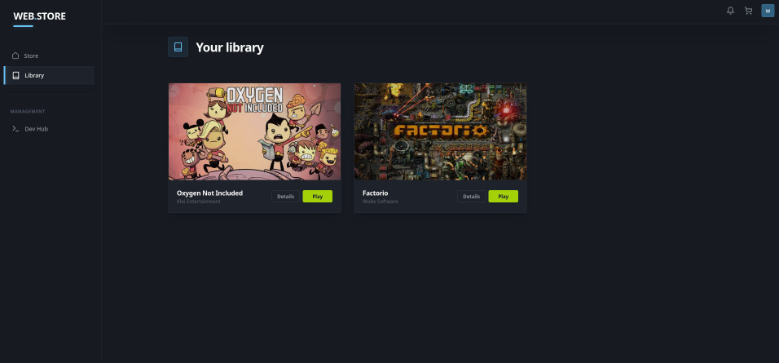
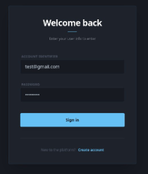
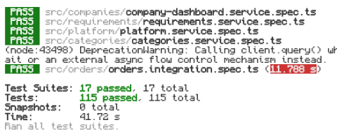

# Online Computer Game Store

A fullstack digital game distribution platform built with **NestJS**, **Angular**, and **PostgreSQL**. Features an atomic checkout system, developer publishing portal with sales analytics, and role-based moderation.

## Screenshots

| Storefront Catalog | User Library |
| :---: | :---: |
|  |  |

| Auth & Security | Jest Test Suite |
| :---: | :---: |
|  |  |

## Tech Stack

* **Backend:** NestJS, TypeScript, TypeORM, PostgreSQL, REST API
* **Frontend:** Angular 17+ (Signals, Standalone Components), Tailwind CSS, Chart.js
* **Auth & Security:** JWT (Access + Refresh tokens with Bcrypt & SHA-256), Role Guards
* **DevOps:** Docker, Docker Compose, Nginx
* **Testing:** Jest (Unit & Integration tests), Supertest (E2E)

## Core Features

* **Gamers:** Real-time catalog filtering (genre, price, F2P), shopping cart, wallet balance with mock card validation, atomic checkout via PostgreSQL transactions, digital library, and reviews.
* **Game Studios:** 4-step publishing wizard (metadata, screenshots, hardware specs, `.zip` build upload), sales analytics with **Chart.js** (units sold, gross revenue), team member invitations, and custom flash sales.
* **Administrators:** Moderation desk for verifying/wiping game builds, platform-wide discount campaigns, and role management.
* **Launcher Integration:** Deep-link support for desktop launcher (`sadstore://open/{gameId}/{token}`).

## Testing

* **115 Unit & Integration Tests:** Complete business logic coverage using repository mocks.
* **8 E2E Scenarios:** Full user journey validation (Studio registration → Game publishing → Customer checkout → Library verification).
  
## Quick Start (Docker)

```bash
# 1. Clone repository
git clone https://github.com/YarikCompany2/online-computer-game-store-3.0.git
cd online-computer-game-store-3.0

# 2. Run with Docker Compose
docker compose up -d --build

# 3. Seed initial demo data
docker compose exec backend npm run seed
```